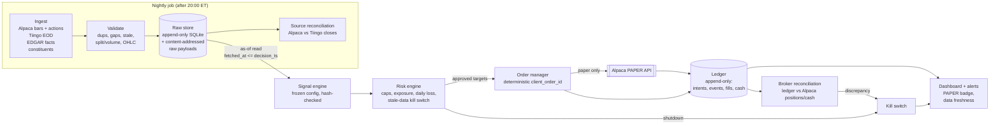

# M1 — Architecture

> **UNVALIDATED / PAPER RESEARCH.** Paper trading only. Nothing here is investment advice.

## 1. Verified starting state (2026-10-09)

| Claim in brief | Verified? | Evidence |
|---|---|---|
| Mobile demo UI (8 sample stocks, synthetic prices) | **Not found** | Not in `kingtobar901-jpg/claude-mem`, the only repo this session can reach. |
| `scan_sp500.py` prototype | **Not found** | Same; `git ls-files` has no match for `sp500` / `tvdatafeed`. |
| Audited backtests / paper returns | **None exist** | Nothing to audit. |

Lynch Paper Lab is built from scratch in `lynch-paper-lab/`. The prototype and the demo UI are treated as reference material only.

## 2. Data flow



Plain-text fallback:

```
ingest -> validate -> [raw store] -> signal(as-of) -> risk -> orders -> ALPACA PAPER
                          |                                    |            |
                          +-> source recon            [ledger] <-----------+
                                                         |
                                       broker recon -> kill switch -> dashboard/alerts
```

## 3. Components and contracts

| Component | Reads | Writes | Key invariant |
|---|---|---|---|
| Ingest | vendor APIs (keys from env) | `fetch_batch`, raw tables, `raw/<sha256>.json.gz` | Never overwrites. Each fetch is a new batch with `fetched_at_utc`, payload hash, and code version. |
| Validate | raw store | `validation_result` | An `error` blocks the batch from as-of reads. |
| Source recon | raw store (2 sources) | `source_reconciliation` | Close difference above the threshold (proposed 5 bps on split-adjusted closes) = mismatch. |
| Signal engine | raw store only, as-of `decision_ts` | `signal`, `target_weight` | Refuses unless config status is `FROZEN` and the hash matches. `data_asof_utc <= decision_ts_utc` is enforced by the DB. |
| Risk engine | targets, ledger state, data freshness | `risk_decision`, `kill_switch_event` | Can reduce or block orders, never add them. Fails closed. |
| Order manager | approved intents | `order_intent`, `order_event` | One intent per (ticker, signal, session). A retry reuses the same `client_order_id`. Credentials only via `lpl.safety`. |
| Ledger | — | `fill`, `cash_entry` | Append-only. Money in integer micro-dollars. State is derived, never updated. |
| Broker recon | ledger, Alpaca positions/cash | `broker_reconciliation` | Any discrepancy engages the kill switch and blocks the next session. |
| Backtester (M5) | same signal and risk code | separate ledger DB, `mode='backtest'` | Same code path as paper, simulated fills at open t+1 plus the cost model. |
| Dashboard (M6/M7) | read-only views | — | Always shows the PAPER badge, the label, and the data age. |

## 4. Schemas

- `schemas/store.sql`: `fetch_batch`, `raw_daily_bar`, `corporate_action`, `index_membership_event`, `security_master`, `validation_result`, `source_reconciliation`.
- `schemas/ledger.sql`: `run`, `signal`, `target_weight`, `risk_decision`, `order_intent`, `order_event`, `fill`, `cash_entry`, `kill_switch_event`, `broker_reconciliation`, `variant_registry`, `variant_result`.

All tables have UPDATE/DELETE-abort triggers. `run.broker_base_url` can only be the paper URL. `signal.label` can only be `UNVALIDATED / PAPER RESEARCH`.

**Adjustments.** Prices are stored as delivered (raw where the source allows), together with `corporate_action` rows. Adjusted series are rebuilt as-of the decision date from the actions known at that point. Vendor-adjusted closes are kept for audit only, because vendors restate them after the fact.

**client_order_id** = `lpl1-YYYYMMDD-SYMBOL-<sha256(symbol|signal|session|config_sha)[:16]>`, see `src/lpl/ids.py`.

## 5. Free data sources: fit and limits (to be verified in M2)

| Need | Proposed source | Known/likely limits |
|---|---|---|
| Daily OHLCV (primary) | Alpaca Market Data, free plan | History starts around 2016. The free plan's recent data is delayed and/or IEX-only (exact terms to be checked in M2). Delisted-symbol coverage is unclear. |
| Daily OHLCV (second source, long history) | Tiingo EOD, free tier | The free tier has request and **unique-symbol-per-month** caps. Covering about 1,000+ historical constituents may take several months of quota or not fit at all. To be measured in M2. |
| Splits / dividends | Alpaca corporate actions; Tiingo divCash/splitFactor | Cross-checked against each other. |
| Fundamentals (arm 2 only) | SEC EDGAR XBRL `companyfacts` | Free and as-reported, with `filed` dates that support point-in-time use. Needs a User-Agent with contact info. Coverage starts around 2009. |
| Historical S&P 500 membership | **No authoritative free source.** Candidates: Wikipedia "changes" table; community GitHub datasets | Incomplete and unaudited, especially before about 2010. **Survivorship bias cannot be fully removed with free data.** This limit is reported on every result. |
| GICS sectors | Current sector from public lists | Not point-in-time (the 2018 GICS reshuffle created Communication Services). The sector cap uses current sectors, a documented look-ahead. |
| SPY total return | SPY bars + dividends | Built by reinvesting dividends on the ex-date. |
| Rejected | tvDatafeed (unofficial private websocket; terms-of-service and reliability risk), paid vendors | — |

## 6. Repo structure

```
lynch-paper-lab/
  config/        strategy_baseline.v1.toml + .sha256 lock (frozen rules)
  schemas/       store.sql, ledger.sql
  src/lpl/       safety.py (paper guard), config.py (hash lock), ids.py, db.py
                 [M2] ingest/, validate/   [M3] risk/   [M4] broker/, ledger/
                 [M5] strategy/, backtest/ [M6] report/ [M7] scheduler/, app/
  tests/         unittest; one test_mN_*.py file per milestone
  experimental/  retired breakout/pullback heuristics (never imported by src/lpl)
  docs/          M1_architecture.md, M1_risk_register.md, M1_test_plan.md
  data/          (gitignored) raw/, store.db, ledger.db
```

## 7. Operational choices

- **Language and runtime:** Python 3.11+. M1 needs only the standard library. Later milestones add `requests`, `pandas`, `numpy`, and `pytest` (all free).
- **Storage:** SQLite (WAL mode) plus gzipped raw payloads. One file per database, easy to back up. Parquet can be added later as an export.
- **Clock:** all timestamps are UTC. Sessions follow the NYSE calendar, including half days, built from Alpaca's `/v2/calendar` (paper endpoint) and stored as data.
- **Scheduler (M7):** must run on an always-on host. The current cloud container is ephemeral and not suitable. Options: GitHub Actions cron (free tier, stores the DB as an artifact or in a private repo) or a home machine. Decision needed at M7.
